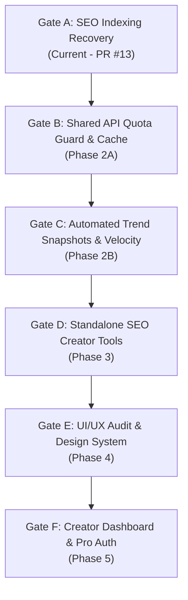

# PLEXUDO MASTER ROADMAP v2.0

**Effective Date:** October 25, 2026  
**Repository:** `https://github.com/fahadbwp/plexodu`  
**Production URL:** `https://plexudo.vercel.app`  
**Current Baseline Commit:** `aa168ac` (Production) / `f32d453` (Gate A PR #13)  
**Architecture:** Python Flask + Vercel Serverless + Supabase PostgreSQL + Groq AI + YouTube Data API v3  

---

## 1. Executive Vision & Invariant Architectural Rules

Plexudo is a specialized, login-free YouTube creator analytics and SEO growth platform. Every engineering phase must adhere strictly to the following foundational invariants:

1. **Claude's October 24, 2026 Audit Baseline:** The original comprehensive audit remains an unalterable benchmark. No finding may be silently dismissed, suppressed, or marked resolved without verifiable tests, code changes, and live environment proof.
2. **Deterministic & Honest Heuristics:** Never fabricate mock metrics, artificial view counts, fabricated competitor benchmarks, or synthetic user reviews. When YouTube API data is omitted or private (e.g. hidden likes), represent it transparently as `Unavailable` (`null`).
3. **Core Stack Preservation:** The application runs on Flask, Vercel Serverless, Supabase PostgreSQL, and Groq AI. No unilateral framework rewrites (e.g. Next.js, Django, FastAPI) are permitted.
4. **Login-Free Creator Utility:** All public SEO tools operate 100% anonymously without requiring login credentials, cookies, or account setup. Authentication is strictly reserved for future opt-in Pro creators (Gate F).
5. **Mobile-First Responsive Integrity:** Zero horizontal scroll across all breakpoints (320px, 390px, 768px, 1024px, 1440px, 1920px). No inline styles for layout-critical flexbox or grid definitions.
6. **Sequential Release Gates:** Never begin an engineering phase until the preceding release gate has passed all mandatory tests, security audits, browser verifications, and owner approvals.

---

## 2. Claude Audit Traceability Matrix (A-to-Z Baseline)

| Finding ID | Audit Area | Original Finding & Severity | Evidence / Source Location | Current Status | Related Commit / PR | Automated Regression Test | Planned Phase |
|---|---|---|---|:---:|---|---|:---:|
| **AUD-01** | Database | Cold-start crash & schema mismatch in Supabase PostgreSQL (High) | `backend/models.py`, `backend/app.py` | **VERIFIED FIXED** | Commit `ae164f0` | `tests/test_db_recovery_*.py` | Phase 0 / 1 |
| **AUD-02** | Security | Legacy user auth routes exposed without CSRF / session leakage (High) | `/api/login`, `/api/register`, `/api/session` | **VERIFIED FIXED** | Commit `ae164f0` | `tests/test_standalone_tools_architecture.py` | Phase 0 / 1 |
| **AUD-03** | Analytics | Arbitrary `+950` momentum saturation cap in velocity calculation (Med) | `backend/services/real_api.py` | **VERIFIED FIXED** | Commit `ae164f0` | `tests/test_trend_practical_regressions.py` | Phase 1 |
| **AUD-04** | API Quota | Generic keyword search used for regional trending instead of `chart=mostPopular` (High) | `backend/services/real_api.py` | **VERIFIED FIXED** | Commit `ae164f0` | `tests/test_phase8_trend_intelligence.py` | Phase 1 |
| **AUD-05** | Analytics | Hidden likes treated as zero instead of `Unavailable` (Med) | `backend/services/real_api.py` | **VERIFIED FIXED** | Commit `ae164f0` | `tests/test_trend_practical_regressions.py` | Phase 1 |
| **AUD-06** | NLP | Urdu and Hindi comments stripped or misclassified during sentiment analysis (Med) | `backend/services/nlp_engine.py` | **VERIFIED FIXED** | Commit `ae164f0` | `tests/test_trend_practical_regressions.py` | Phase 1 |
| **AUD-07** | SEO Engine | Lack of deterministic 50/50 SEO scoring engine (High) | `backend/services/seo_engine_v1.py` | **VERIFIED FIXED** | PR #12 (`d8ab789`) | `tests/test_seo_intelligence_v1.py` | Phase 1.5 |
| **AUD-08** | SEO Indexing | Flask catch-all serving `index.html` for legal & blog routes causing Soft 404s (High) | `backend/app.py` lines 255-259 | **VERIFIED FIXED** | PR #13 (`f32d453`) | `tests/test_seo_indexing_recovery.py` | Gate A |
| **AUD-09** | SEO Indexing | Blog guides 1–3 implemented only as JS modals, hidden from web crawlers (High) | `frontend/index.html`, `frontend/blog/index.html` | **VERIFIED FIXED** | PR #13 (`f32d453`) | `tests/test_seo_indexing_recovery.py` | Gate A |
| **AUD-10** | SEO Indexing | Legal pages split canonical (`/privacy.html` vs `/privacy`) serving 200 without 301 (Med) | `frontend/privacy.html`, `vercel.json` | **VERIFIED FIXED** | PR #13 (`f32d453`) | `tests/test_seo_indexing_recovery.py` | Gate A |
| **AUD-11** | SEO Indexing | Sitemap missing 3 blog guides and referencing redirected `.html` files (Med) | `frontend/sitemap.xml` | **VERIFIED FIXED** | PR #13 (`f32d453`) | `tests/test_phase4_seo_vercel.py` | Gate A |
| **AUD-12** | Quota Guard | Process-local `YouTubeQuotaTracker` resets on cold-start in serverless (High) | `backend/services/real_api.py` | **OPEN / IN DESIGN** | Phase 2 Architecture Spec | Pending Phase 2 Implementation | Gate B |
| **AUD-13** | Caching | `BoundedTTLCache` in-memory only, no cross-instance cache in serverless (High) | `backend/services/real_api.py` | **OPEN / IN DESIGN** | Phase 2 Architecture Spec | Pending Phase 2 Implementation | Gate B |
| **AUD-14** | Rate Limiting | `SlidingWindowRateLimiter` in-memory only, vulnerable to multi-instance floods (High) | `backend/services/security_guard.py` | **OPEN / IN DESIGN** | Phase 2 Architecture Spec | Pending Phase 2 Implementation | Gate B |
| **AUD-15** | Background | No automated snapshot cron job for regional trending time-series data (Med) | `backend/app.py`, `vercel.json` | **DEFERRED** | Phase 2B Scope | Pending Gate C | Gate C |
| **AUD-16** | Tools UI | Creator tools lack unified standalone routing hubs (Med) | `frontend/tools/*.html` | **PARTIAL** | Standalone tool routes live | `tests/test_standalone_tools_architecture.py` | Gate D |
| **AUD-17** | UI/UX | Mixed dark/light remnants, inconsistent color tokens across dashboards (Low) | `frontend/css/style.css` | **DEFERRED** | Phase 5 UI/UX Scope | Pending Gate E | Gate E |
| **AUD-18** | Subscriptions | No creator accounts, saved history, or Pro tiers (Low) | Future Roadmap | **DEFERRED** | Phase 6 Auth Scope | Pending Gate F | Gate F |

---

## 3. Sequential Release Gates & Implementation Phases

### Gate A — SEO Indexing Recovery & Search Console Optimization (CURRENT)
- **Objective:** Fix GSC indexing flags (`Discovered - not indexed`, `Duplicate without user-selected canonical`, `Soft 404`).
- **Deliverables:**
  - 3 restored crawlable HTML guides in `frontend/blog/`.
  - Clean semantic links on homepage and blog index.
  - Dedicated Flask and Vercel routing with clean legal URLs (`/privacy`, `/terms`) and single-hop 301 redirects.
  - Authoritative 13-URL canonical sitemap with `2026-10-25` `lastmod` timestamps.
  - Preservation of Google Search Console verification tokens.
- **Verification:** 15 dedicated SEO recovery tests, 307 total passing tests, 60 multi-breakpoint browser QA screenshots.

### Gate B — Phase 2A: Shared API Quota Guard, Shared Cache & Distributed Rate Limiting
- **Objective:** Protect production YouTube API quotas and Groq LLM workloads from serverless concurrency leaks.
- **Deliverables:**
  - Supabase PostgreSQL / Redis distributed atomic quota reservation state machine.
  - Non-refunding of dispatched requests, lease expiry crash recovery, and midnight Pacific Time rollover.
  - Distributed token bucket rate limiter with trusted client IP resolution (rejection of spoofed headers).
  - Single-flight shared cache with worker lock ownership validation to prevent stale overwrites.

### Gate C — Phase 2B: Automated Trend Snapshots, Observed Velocity & Policy Compliance
- **Objective:** Establish longitudinal data collection for high-fidelity velocity curves and creator forecasts.
- **Deliverables:**
  - Automated Vercel cron triggers for regional trend snapshots (`videos.list?chart=mostPopular`).
  - Observed 7-day, 14-day, and 28-day velocity calculation with moving average smoothing.
  - YouTube Developer Policy compliance verification (data refresh bounds and storage limits).

### Gate D — Phase 3: Standalone SEO Creator Tools Architecture
- **Objective:** Deepen creator utilities into standalone, high-performance web applications.
- **Deliverables:**
  - Full feature polish for Trend Analyzer, Video Virality Analyzer, Competitor Audit, and AI Strategist.
  - PDF export streaming directly from memory without disk dependencies.

### Gate E — Professional UI/UX Audit, Design System & Responsive Redesign
- **Objective:** Elevate visual aesthetics to top-tier SaaS standards.
- **Deliverables:**
  - Complete adoption of Bento-box design tokens across all components.
  - Elimination of all inline layout styles.
  - Dark mode support with persistent preference toggling.

### Gate F — Creator Dashboard, Supabase Authentication & Subscriptions
- **Objective:** Monetization readiness and creator personalization.
- **Deliverables:**
  - Optional Supabase JWT authentication for saving channels and video audit histories.
  - Free vs. Pro tier quota allocations.
  - Payment gateway integration (Stripe / LemonSqueezy) with webhook settlement.

---

## 4. Parallel Growth & Operational Workstreams

Outside of core engineering gates, continuous organic operations proceed without code disruption:
1. **Search Console & Bing Webmaster Monitoring:** Weekly inspection of indexed vs. unindexed URLs, sitemap crawl health, and keyword impression trends.
2. **High-Utility Content Publishing:** Regular addition of long-form, data-driven guides in `frontend/blog/` covering YouTube algorithm updates and creator case studies.
3. **Ethical Creator Outreach:** Direct creator discovery and community engagement without automated spamming.
4. **Privacy-First Analytics:** Tracking creator tool usage anonymously to inform feature prioritization.
